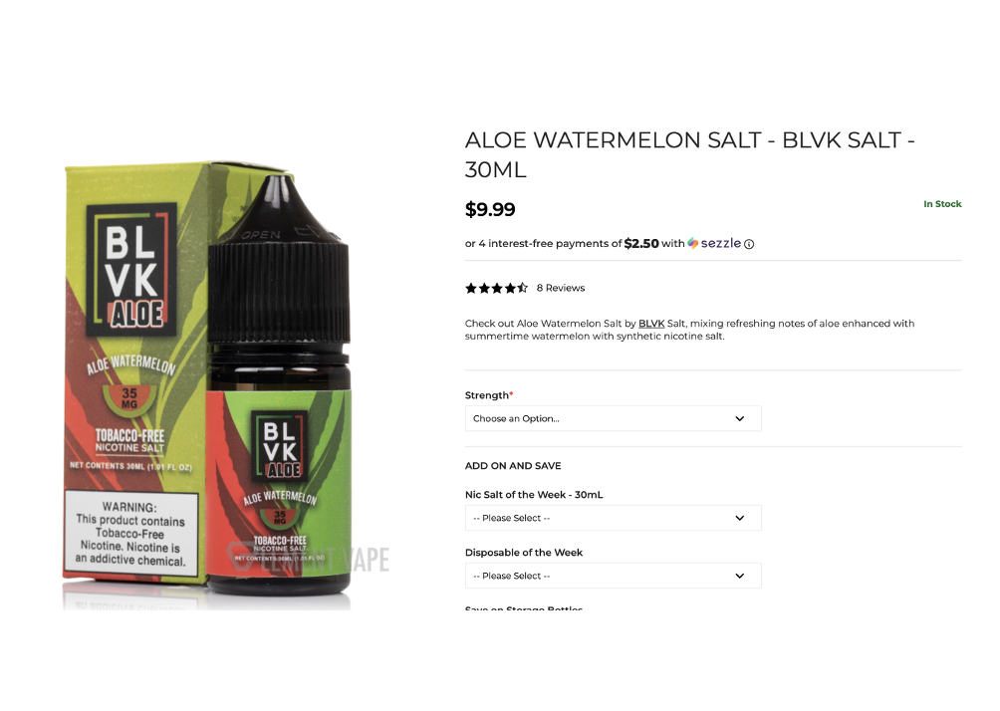
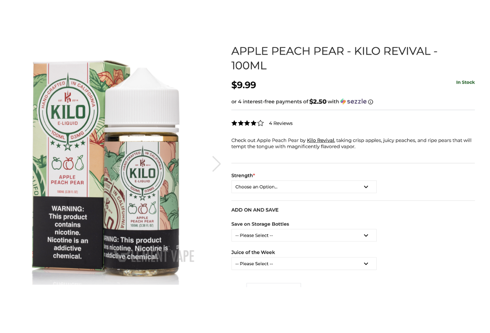
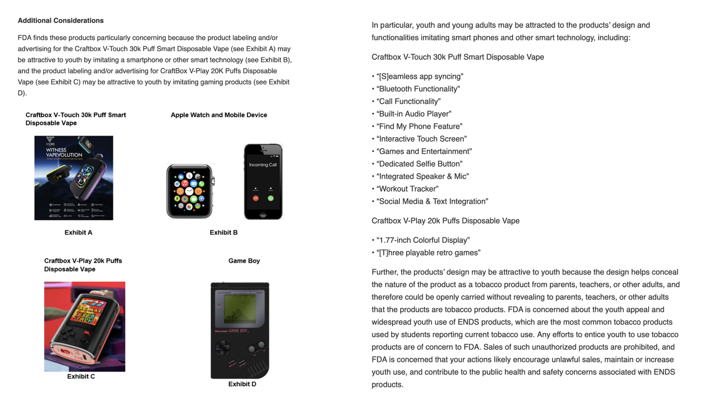
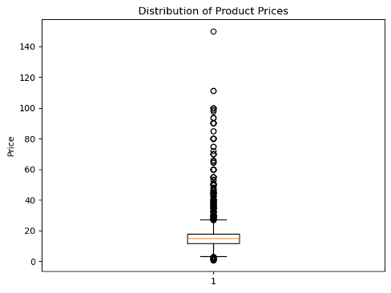
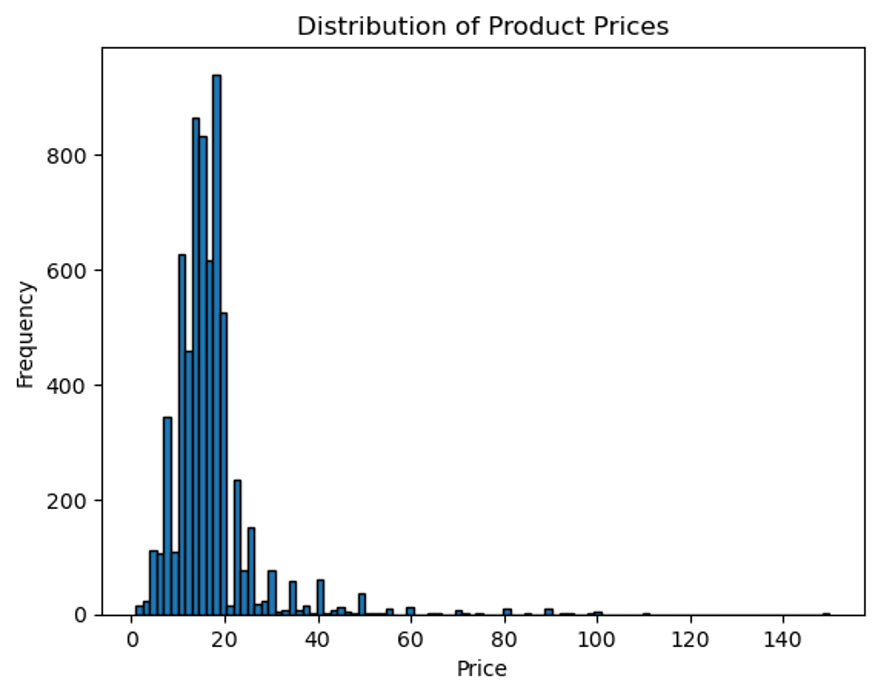
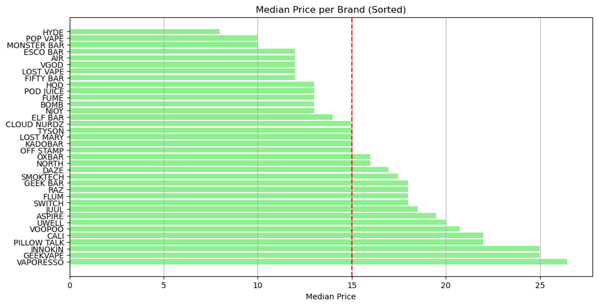
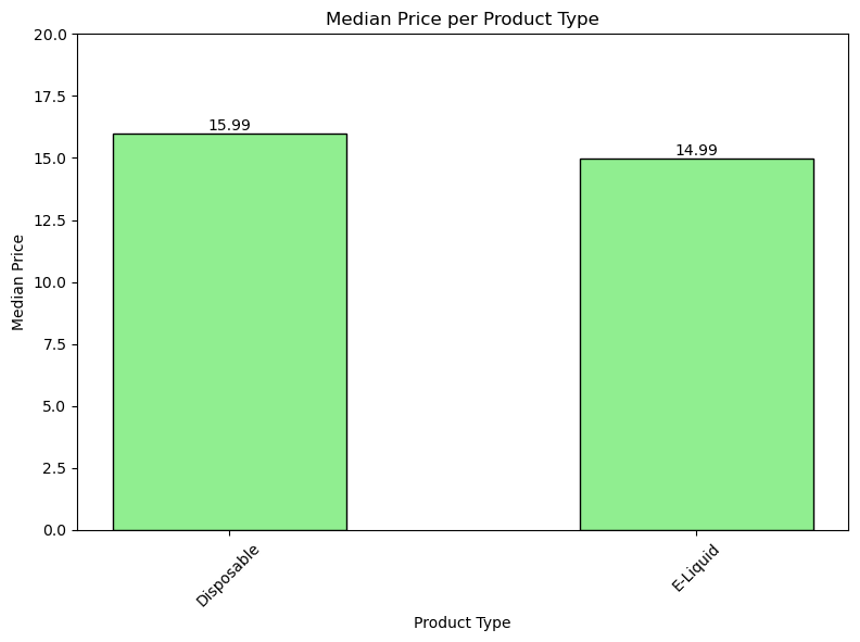

Updates - Oct 30, 2025
----------------------

Agenda
======

- Updates

  - CV
  - Data
  - Price Analysis
  - NLP
  - Publication
  - Training

Computer Vision Overview
========================

- Since our last meeting we have added many different sites to our dataset.

- We are now using some or all the juice products from 7 different websites. 

- We now have a total of 1326 products verified with only 11 being incorrectly predicted, resulting in 99% accuracy.

- We did have an issue with the vapesourcing.com data, the VLM could not access the webpage of any of the products, so that website has been skipped.

- Verification of products is continuing until we reach ~2000 products which would match the number verified for screen detection.

Performance Matrix
==================

+-------------------+---------+-----------+-----------+-------------+----------+
| Site              | # Juices| # Verified| # Correct | # Incorrect | Accuracy |
+===================+=========+===========+===========+=============+==========+
| vape.com          | 3787    | 500       | 493       | 7           | 98.60%   |
+-------------------+---------+-----------+-----------+-------------+----------+
| perfectvape.com   | 338     |           |           |             |          |
+-------------------+---------+-----------+-----------+-------------+----------+
| elementvape.com   | 2179    | 154       | 153       | 1           | 99.28%   |
+-------------------+---------+-----------+-----------+-------------+----------+
| vapingdotcom      | 232     | 232       | 230       | 2           | 99.14%   |
+-------------------+---------+-----------+-----------+-------------+----------+
| vapewh.com        | 58      | 58        | 58        | 0           | 100.00%  |
+-------------------+---------+-----------+-----------+-------------+----------+
| getpop.com        | 56      | 56        | 56        | 0           | 100.00%  |
+-------------------+---------+-----------+-----------+-------------+----------+
| csvape.com        | 327     | 326       | 325       | 1           | 99.69%   |
+-------------------+---------+-----------+-----------+-------------+----------+
| **TOTAL**         | **1326**| **1315**  | **11**    | **99.17%**  |          |
+-------------------+---------+-----------+-----------+-------------+----------+

Element Vape Reviews
====================

- Unlike many of the other sites we have evaluated, Element Vape has a large quantity of reviews.

- Almost all the 150 products I verified had at least 1 review, most had 5 or more. 

- This seemed to add some additional context and information to some products which would not normally be considered "iced".

- There are a few products that have no imagery, text, or description that would indicate a cooling effect; however, the reviews specifically call it out as having that effect.

Example Response
================

Yes - The flavor reviews for "Aloe Watermelon Salt - BLVK Salt" on the product webpage explicitly mention cooling terminology. One review states, "unfortunately, it is very icy" and refers to it as "menthol/ freeze juice". Another review mentions it's "not too harsh on the menthol side", and a third review notes a "Nice light menthol".

Example Response
================

Yes - The product name "Apple Peach Pear" does not contain any cooling suggestions. The product image does not display any ice imagery or text indicating a cooling effect. However, one customer review explicitly states, "Should say ice flavor. I don't care for ice flavors and this definitely is that. It should be in the description. I was really excited to try this one and I feel like the cooling overpowered any of the fruit flavor." This review confirms the presence of a cooling sensation.

Issue with Reviews
==================

- There is a small issue with these reviews being used as the sole reason for a decision.

- Most products come in multiple sizes (ex: 30ml, 60ml, etc.) and they do not share the same webpage, thus one size with an "icy" review may be marked as iced while the rest of the same flavor is not.

- I am not sure how to resolve this inconsistency; would we consider it incorrect even though the model would have no idea because it did not see the same review as the other product page.

CSVape.com Update
=================

- As of September 23rd 2025, CSVape.com has closed its online store, in their words to "comply with federal policies".

- The website is still viewable and products can still be seen and run by our VLM, however they have a large banner stating their closed and all items are listed as discontinued.

- We did some further investigation and found a letter they received on October 29, 2024 from the FDA Office of Compliance and Enforcement Center for Tobacco Products, notifying them that they were selling products without a premarket authorization order.

- In this letter they specifically call out products that are attractive to youth with screenshots of products that they sell which contain screens.

- They also call out a number of features that they feel attracts youth to the products.

Preliminary Price Analysis
==========================

- 6,472 valid prices after preprocessing
 
  - Default Price was given priority over any Sale Price
  - Thoughts on dry herb vaporizers/dry pipe

- Descriptive Statistics
 
  - Mean $16.54
  - Std $9.34
  - Median $14.99
  - IQR ($11.99, $17.99)
  - Range ($0.99, $149.99)

Price Analysis by Brand
========================

- Filtered for products with frequency >50 in our dataset
- 36 brands met this threshold, 4324 products out of 6472 total
- For these brands,
  
  - Median $14.99
  - IQR ($12.38, $18.49)
  - Range ($0.99, $110.99)

Price Analysis by Product Type
==============================

- 2198 Disposables, 545 E-liquids analyzed

  - Planning to expand analysis to all our product types

- For these product types,

  - Disposable

    - Md $15.99 with IQR ($12.99, $19.99)
  - E-liquid

    - Md $14.99 with IQR ($12.99, $17.95)

NLP Updates
===========

- Coded an interactive Jupyter Notebook to try custom prompts for Llama model to run on our dataset

  - This will be available on the Github repo for use!

- Ad-hoc meeting for flavor categorization

- Concept Proposal
  
  - Flavors
    
    - Next steps
  - Gap Analysis
    
    - Are we planning to incorporate NIQ data or just focus on Circana?